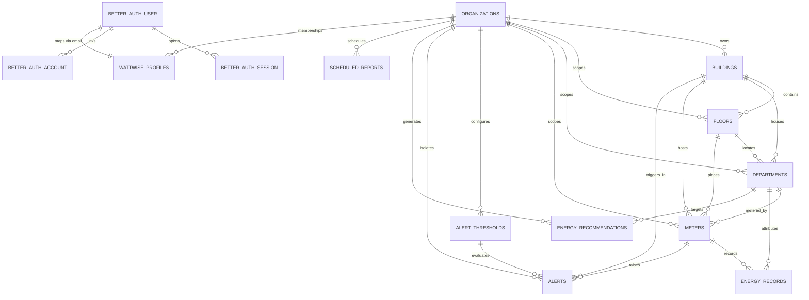

# WattWise Database Design

WattWise uses **MongoDB** (default database name `wattwise`, configurable via `MONGODB_DB_NAME`) as a single unified store for multi-tenant facility hierarchies, time-series electricity consumption readings, alerting rules, energy insights, RBAC user profiles, and Better Auth identity collections.

> [!NOTE]
> Domain documents are validated at write-time with Zod schemas (`backend/src/schemas/validators.js`) and protected by 21 unique and compound indexes initialized automatically in `backend/src/config/db.js`.

---

## Entity-Relationship Diagram

---

## Domain Collections (11 Collections)

### 1. `organizations`
Stores multi-tenant organization metadata, default electricity tariffs, and carbon emission factors.

| Field | Type | Constraints / Default | Description |
| :--- | :--- | :--- | :--- |
| `_id` | `ObjectId` | Primary Key | Organization identifier |
| `name` | `string` | Required, 2–120 chars | Display name (e.g. `Northgrid Commercial Holdings`) |
| `slug` | `string` | Unique index | URL-safe slug identifier |
| `industry` | `string` | 2–80 chars, default `Commercial Real Estate` | Industry vertical |
| `timezone` | `string` | 2–60 chars, default `UTC` | IANA timezone |
| `currency` | `string` | 3–6 chars, default `USD` | Billing currency code |
| `tariffPerKwh` | `number` | Positive, `<= 10`, default `0.145` | Default tariff rate ($/kWh) |
| `emissionFactorKgPerKwh` | `number` | Positive, `<= 5`, default `0.412` | CO2e factor (kg CO2e/kWh) |
| `contactEmail` | `string` | Optional valid email | Organization operations contact |
| `ownerEmail` | `string` | Creator email | Admin owner authorized for multi-org switching |
| `createdAt` | `Date` | Auto timestamp | Creation time |
| `updatedAt` | `Date` | Auto timestamp | Last modification time |

---

### 2. `buildings`
Stores physical buildings belonging to an organization along with monthly energy targets.

| Field | Type | Constraints / Default | Description |
| :--- | :--- | :--- | :--- |
| `_id` | `ObjectId` | Primary Key | Building identifier |
| `organizationId` | `ObjectId` | Ref `organizations._id` | Owning organization |
| `name` | `string` | Required, 2–120 chars | Building name |
| `code` | `string` | Required, 2–24 chars, uppercase, unique per org | Building code (e.g. `NG-TWR-A`) |
| `address` | `string` | Required, 3–200 chars | Street address |
| `city` | `string` | Required, 2–80 chars | City |
| `totalSqFt` | `number` | Positive, `<= 10000000` | Gross floor area (sq ft) |
| `targetMonthlyKwh` | `number` | Positive, `<= 100000000` | Monthly consumption budget (kWh) |
| `status` | `string` | Enum `Operational` \| `Maintenance` | Operating status |
| `createdAt` | `Date` | Auto timestamp | Creation time |

---

### 3. `floors`
Stores building floors with square footage and numeric floor levels.

| Field | Type | Constraints / Default | Description |
| :--- | :--- | :--- | :--- |
| `_id` | `ObjectId` | Primary Key | Floor identifier |
| `organizationId` | `ObjectId` | Ref `organizations._id` | Owning organization |
| `buildingId` | `ObjectId` | Ref `buildings._id` | Parent building |
| `floorNumber` | `number` | Int `-10..200`, unique per building | Numeric floor level |
| `name` | `string` | Required, 2–120 chars | Floor label |
| `areaSqFt` | `number` | Positive, `<= 2000000` | Floor area (sq ft) |
| `createdAt` | `Date` | Auto timestamp | Creation time |

---

### 4. `departments`
Stores organizational departments scoped to a building and floor, used for Department Manager RBAC isolation and cost budgeting.

| Field | Type | Constraints / Default | Description |
| :--- | :--- | :--- | :--- |
| `_id` | `ObjectId` | Primary Key | Department identifier |
| `organizationId` | `ObjectId` | Ref `organizations._id` | Owning organization |
| `buildingId` | `ObjectId` | Ref `buildings._id` | Parent building |
| `floorId` | `ObjectId` | Ref `floors._id` | Assigned floor |
| `name` | `string` | Required, 2–120 chars | Department name |
| `code` | `string` | 2–24 chars, uppercase, unique per org | Department code |
| `costCenter` | `string` | Required, 2–40 chars | Internal cost center code |
| `monthlyBudgetUsd` | `number` | Positive, `<= 10000000` | Monthly electricity budget (USD) |
| `headcount` | `number` | Int `1..50000`, default `20` | Staff headcount |
| `createdAt` | `Date` | Auto timestamp | Creation time |

---

### 5. `meters`
Stores electricity sub-meters and main feeders, including baseline targets, alert ceiling thresholds, and health telemetry.

| Field | Type | Constraints / Default | Description |
| :--- | :--- | :--- | :--- |
| `_id` | `ObjectId` | Primary Key | Meter identifier |
| `organizationId` | `ObjectId` | Ref `organizations._id` | Owning organization |
| `buildingId` | `ObjectId` | Ref `buildings._id` | Parent building |
| `buildingName` | `string` | Denormalized | Cached building name |
| `floorId` | `ObjectId` | Ref `floors._id` | Assigned floor |
| `departmentId` | `ObjectId` | Ref `departments._id` | Assigned department |
| `departmentName` | `string` | Denormalized | Cached department name |
| `meterCode` | `string` | 3–32 chars, uppercase, unique per org | Meter serial/code |
| `name` | `string` | 2–120 chars | Human-readable meter label |
| `meterType` | `string` | Enum `HVAC`, `Lighting`, `Production`, `Server Room`, `Main Feeder`, `Chiller` | Meter category |
| `unit` | `string` | `kWh` | Measurement unit |
| `ratedCapacityKw` | `number` | Positive, `<= 50000` | Rated load capacity |
| `baselineHourlyKwh` | `number` | Positive, `<= 50000` | Expected hourly baseline |
| `thresholdHourlyKwh` | `number` | Positive, `<= 50000` | Alert trigger threshold |
| `tariffPerKwh` | `number` | Positive, `<= 10`, default `0.145` | Applied energy tariff |
| `emissionFactorKgPerKwh` | `number` | Derived from org or `0.412` | Applied CO2e factor |
| `healthStatus` | `string` | Enum `Healthy` \| `Degraded` \| `Offline` | Telemetry health status |
| `voltage` | `number` | Default `480.0` (simulated `477..483`) | Line voltage |
| `powerFactor` | `number` | `0.1..1.0`, default `0.96` | Power factor |
| `lastReadingAt` | `Date` | Timestamp | Most recent ingestion timestamp |
| `createdAt` | `Date` | Auto timestamp | Registration timestamp |

---

### 6. `energy_records`
Stores high-volume time-series electricity consumption readings with precomputed cost, carbon footprint, and anomaly flags.

| Field | Type | Constraints / Default | Description |
| :--- | :--- | :--- | :--- |
| `_id` | `ObjectId` | Primary Key | Record identifier |
| `organizationId` | `ObjectId` | Ref `organizations._id` | Owning organization |
| `buildingId` | `ObjectId` | Ref `buildings._id` | Building reference |
| `floorId` | `ObjectId` | Ref `floors._id` | Floor reference |
| `departmentId` | `ObjectId` | Ref `departments._id` | Department reference |
| `meterId` | `ObjectId` | Ref `meters._id` (unique with `timestamp`) | Source meter |
| `meterCode` | `string` | Denormalized | Meter code for fast search/CSV export |
| `buildingName` | `string` | Denormalized | Building name |
| `departmentName` | `string` | Denormalized | Department name |
| `consumptionKwh` | `number` | `0..500000`, rounded to 2 decimals | Consumption value (kWh) |
| `demandKw` | `number` | `0..500000` | Peak/instantaneous demand (kW) |
| `powerFactor` | `number` | `0.1..1.0`, default `0.96` | Measured power factor |
| `estimatedCost` | `number` | `consumptionKwh * tariffPerKwh` | Estimated cost (2 decimals) |
| `carbonKg` | `number` | `consumptionKwh * emissionFactor` | Estimated CO2e in kg (2 decimals) |
| `timestamp` | `Date` | Unique with `meterId` | UTC reading timestamp |
| `isAnomaly` | `boolean` | `consumptionKwh > thresholdHourlyKwh` | Anomaly classification flag |
| `source` | `string` | `seeded` \| `manual` \| `simulation` | Origin of record |
| `createdAt` | `Date` | Auto timestamp | Insertion timestamp |

---

### 7. `alert_thresholds`
Stores facility manager rules evaluated on manual ingestion and simulation ticks.

| Field | Type | Constraints / Default | Description |
| :--- | :--- | :--- | :--- |
| `_id` | `ObjectId` | Primary Key | Rule identifier |
| `organizationId` | `ObjectId` | Ref `organizations._id` | Owning organization |
| `buildingId` | `ObjectId \| null` | Nullable (`null` = all buildings) | Target building scope |
| `meterId` | `ObjectId \| null` | Nullable (`null` = all meters) | Target meter scope |
| `name` | `string` | Required, 2–120 chars | Rule display title |
| `metric` | `string` | Enum `hourly_kwh` \| `daily_kwh` \| `spike_ratio` | Evaluated metric |
| `limitValue` | `number` | Positive, `<= 1000000` | Numeric threshold ceiling |
| `spikeMultiplier` | `number` | `1.1..10`, default `1.65` | Baseline ratio multiplier |
| `severity` | `string` | Enum `High` \| `Medium` \| `Low` | Generated alert severity |
| `enabled` | `boolean` | Default `true` | Rule active flag |
| `createdBy` | `string` | Creator email / `system-seed` | Audit creator |
| `createdAt` | `Date` | Auto timestamp | Creation timestamp |
| `updatedAt` | `Date` | Auto timestamp | Last modification timestamp |

---

### 8. `alerts`
Stores threshold violation and unusual consumption events across lifecycle states.

| Field | Type | Constraints / Default | Description |
| :--- | :--- | :--- | :--- |
| `_id` | `ObjectId` | Primary Key | Alert identifier |
| `organizationId` | `ObjectId` | Ref `organizations._id` | Owning organization |
| `buildingId` | `ObjectId` | Ref `buildings._id` | Building reference |
| `buildingName` | `string` | Denormalized | Cached building name |
| `floorId` | `ObjectId` | Ref `floors._id` | Floor reference |
| `departmentId` | `ObjectId` | Ref `departments._id` | Department reference |
| `departmentName` | `string` | Denormalized | Cached department name |
| `meterId` | `ObjectId` | Ref `meters._id` | Triggering meter |
| `meterCode` | `string` | Denormalized | Triggering meter code |
| `thresholdId` | `ObjectId \| null` | Ref `alert_thresholds._id` | Matching rule (if any) |
| `title` | `string` | Required | Summary headline |
| `description` | `string` | Required | Measured vs limit detail |
| `alertType` | `string` | `High Usage` \| `Unusual Consumption` | Alert classification |
| `severity` | `string` | Enum `High` \| `Medium` \| `Low` | Severity level |
| `status` | `string` | Enum `New` \| `Acknowledged` \| `Resolved` | Triage workflow status |
| `measuredValue` | `number` | kWh reading | Recorded consumption |
| `thresholdValue` | `number` | kWh threshold | Configured threshold limit |
| `unit` | `string` | `kWh` | Unit label |
| `triggeredAt` | `Date` | Timestamp | Event timestamp |
| `acknowledgedBy` | `string \| null` | Operator name | Acknowledging operator |
| `acknowledgedAt` | `Date \| null` | Timestamp | Acknowledgement time |
| `resolvedBy` | `string \| null` | Operator name | Resolving operator |
| `resolvedAt` | `Date \| null` | Timestamp | Resolution time |

---

### 9. `energy_recommendations`
Stores AI/rule-driven energy optimization actions per organization and department.

| Field | Type | Constraints / Default | Description |
| :--- | :--- | :--- | :--- |
| `_id` | `ObjectId` | Primary Key | Recommendation identifier |
| `organizationId` | `ObjectId` | Ref `organizations._id` | Owning organization |
| `buildingId` | `ObjectId` | Ref `buildings._id` | Target building |
| `buildingName` | `string` | Denormalized | Cached building name |
| `departmentId` | `ObjectId` | Ref `departments._id` | Target department |
| `departmentName` | `string` | Denormalized | Cached department name |
| `title` | `string` | Required | Recommendation headline |
| `category` | `string` | Required | Optimization category |
| `summary` | `string` | Required | Actionable detail |
| `estimatedMonthlySavingsUsd` | `number` | USD/month | Projected monthly savings |
| `estimatedKwhReduction` | `number` | kWh/month | Projected monthly kWh reduction |
| `status` | `string` | `Open` \| `Accepted` \| `Dismissed` | Workflow status |
| `updatedBy` | `string` | Optional operator email | Last reviewer |
| `updatedAt` | `Date` | Optional timestamp | Last status change |
| `createdAt` | `Date` | Auto timestamp | Creation timestamp |

---

### 10. `scheduled_reports`
Stores automated recurring CSV/PDF energy report schedules.

| Field | Type | Constraints / Default | Description |
| :--- | :--- | :--- | :--- |
| `_id` | `ObjectId` | Primary Key | Schedule identifier |
| `organizationId` | `ObjectId` | Ref `organizations._id` | Owning organization |
| `name` | `string` | Required, 2–120 chars | Schedule name |
| `frequency` | `string` | Enum `Daily` \| `Weekly` \| `Monthly` | Delivery cadence |
| `format` | `string` | Enum `CSV` \| `PDF` | Output format |
| `recipients` | `string[]` | Array of emails (`min(1)`) | Recipient distribution list |
| `buildingId` | `ObjectId \| null` | Nullable (`null` = org-wide) | Building scope |
| `lastSentAt` | `Date \| null` | Timestamp | Most recent dispatch |
| `nextRunAt` | `Date` | Timestamp | Next scheduled execution |
| `enabled` | `boolean` | Default `true` | Schedule enabled flag |
| `createdBy` | `string` | Creator email | Audit author |
| `createdAt` | `Date` | Auto timestamp | Creation timestamp |

---

### 11. `wattwise_profiles`
Bridges authenticated Better Auth accounts (by `email`) to organization tenancy, RBAC roles, department scope, and UI preferences.

| Field | Type | Constraints / Default | Description |
| :--- | :--- | :--- | :--- |
| `_id` | `ObjectId` | Primary Key | Profile identifier |
| `email` | `string` | Unique index | Matches authenticated user email |
| `name` | `string` | Min 2 chars | Display name |
| `organizationId` | `ObjectId` | Ref `organizations._id` | Active organization tenancy |
| `role` | `string` | Enum `Organization Admin`, `Facility Manager`, `Department Manager`, `Viewer` | Active RBAC role |
| `requestedRole` | `string \| null` | `Facility Manager` \| `Department Manager` \| `null` | Pending role upgrade requested during join |
| `requestStatus` | `string \| null` | `Pending` \| `Approved` \| `Dismissed` \| `null` | Admin review status for requested role |
| `requestedAt` | `Date \| null` | Optional timestamp | When elevated role was requested |
| `reviewedBy` | `string \| null` | Optional Admin email | Admin who approved/dismissed the request |
| `reviewedAt` | `Date \| null` | Optional timestamp | Decision timestamp |
| `departmentIds` | `ObjectId[]` | Default `[]` | Authorized departments (for `Department Manager`) |
| `themePreference` | `string` | `dark` \| `light` | Saved UI theme |
| `timezone` | `string` | e.g. `America/New_York`, `UTC` | User timezone preference |
| `status` | `string` | Enum `Active` \| `Suspended` | Account access state |
| `createdAt` | `Date` | Auto timestamp | Provisioned timestamp |
| `updatedAt` | `Date` | Auto timestamp | Last modification timestamp |

---

## Authentication Collections (Better Auth)

Managed automatically in the same MongoDB database by `@better-auth/mongo-adapter` (`frontend/src/lib/auth.ts`):

- `user` — Primary identity records (`email`, `name`, `emailVerified`, `image`, timestamps).
- `session` — Active browser sessions & expiration tokens.
- `account` — Credential password hashes and linked Google OAuth provider tokens (`accountLinking` enabled).
- `verification` — OAuth state and verification tokens.

---

## MongoDB Indexes (21 Domain Indexes)

All 21 indexes below are idempotently declared in `ensureIndexes()` inside [`backend/src/config/db.js`](../backend/src/config/db.js):

| Collection | Key Pattern | Options | Purpose |
| :--- | :--- | :--- | :--- |
| `organizations` | `{ slug: 1 }` | `unique: true` | Prevent duplicate org slugs |
| `buildings` | `{ organizationId: 1, code: 1 }` | `unique: true` | Unique building codes per org |
| `buildings` | `{ organizationId: 1 }` | — | Tenant building queries |
| `floors` | `{ buildingId: 1, floorNumber: 1 }` | `unique: true` | Unique floor numbers per building |
| `floors` | `{ organizationId: 1, buildingId: 1 }` | — | Scoped floor listing |
| `departments` | `{ organizationId: 1, code: 1 }` | `unique: true` | Unique department codes per org |
| `departments` | `{ organizationId: 1, buildingId: 1, floorId: 1 }` | — | Hierarchy lookup |
| `meters` | `{ organizationId: 1, meterCode: 1 }` | `unique: true` | Unique meter codes per org |
| `meters` | `{ organizationId: 1, buildingId: 1, departmentId: 1 }` | — | Scoped meter lookup & RBAC filtering |
| `energy_records` | `{ meterId: 1, timestamp: 1 }` | `unique: true` | **Duplicate record guard** per meter/timestamp |
| `energy_records` | `{ organizationId: 1, timestamp: -1 }` | — | Primary org time-series pagination & `$facet` |
| `energy_records` | `{ organizationId: 1, buildingId: 1, timestamp: -1 }` | — | Building-filtered time-series queries |
| `energy_records` | `{ organizationId: 1, departmentId: 1, timestamp: -1 }` | — | Department-scoped time-series & RBAC queries |
| `energy_records` | `{ organizationId: 1, isAnomaly: 1, timestamp: -1 }` | — | Fast anomaly & insights retrieval |
| `alert_thresholds` | `{ organizationId: 1, enabled: 1 }` | — | Active rule evaluation during ingestion |
| `alerts` | `{ organizationId: 1, status: 1, triggeredAt: -1 }` | — | Alert triage list & status counts |
| `alerts` | `{ organizationId: 1, buildingId: 1, triggeredAt: -1 }` | — | Building-filtered alerts feed |
| `wattwise_profiles` | `{ email: 1 }` | `unique: true` | 1:1 auth email to RBAC profile lookup |
| `wattwise_profiles` | `{ organizationId: 1, role: 1 }` | — | Org user directory queries |
| `energy_recommendations` | `{ organizationId: 1, status: 1 }` | — | Insights recommendation filtering |
| `scheduled_reports` | `{ organizationId: 1, enabled: 1 }` | — | Active scheduled reports lookup |

---

## Sample Dataset Specification

Running `npm --prefix backend run seed` executes [`backend/src/scripts/seed.js`](../backend/src/scripts/seed.js) using a deterministic Mulberry32 PRNG (`seed = 42069`) anchored at `2026-11-25T14:00:00.000Z`:

| Entity | Minimum Required | Seed Script Baseline |
| :--- | :--- | :--- |
| Organizations | `3` | `3` (live Atlas holds seeded orgs + interactive user registrations) |
| Buildings | `10` | `12` (`5` Northgrid, `4` Apex Fab, `3` Metro University) |
| Floors | `30` | `36` (`3` per building) |
| Departments | `50` | `60` (`5` per building) |
| Electricity Meters | — | `84` (`7` per building) |
| Time-Series Energy Records | `50,000` | `60,480` (`84 meters x 720 timestamps`, Sep 1 – Nov 25, 2026) |
| Alert Thresholds | — | `6` (`2` per organization) |
| Recommendations | — | `12` (`4` per organization) |
| Scheduled Reports | — | `3` (Weekly PDF, Daily CSV, Monthly PDF) |
